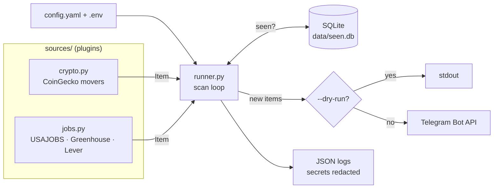
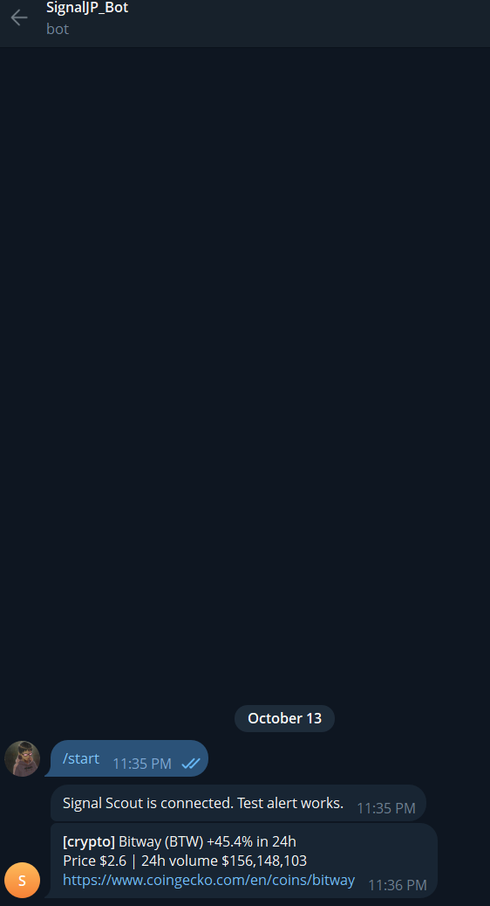

# signal-scout

[](https://github.com/Jparker9204/signal-scout/actions/workflows/ci.yml)


A small, pluggable **Python 3.12** automation service that scans public data sources on a
schedule, filters the results, de-duplicates them in SQLite, and sends **Telegram** alerts.

Out of the box it watches:

- **Jobs**: entry-level IT postings (help desk, IT support, sysadmin, network) from
  USAJOBS plus Greenhouse and Lever public job boards, filtered by keyword, location and salary.
- **Crypto market movers**: read-only CoinGecko market data, alerting on big 24h moves
  with configurable thresholds. It only reads public prices; there is no trading or wallet code.

## Features

- **Plugin architecture**: each source subclasses `Source` and returns normalized `Item`s.
  Adding a source means writing one class and registering it.
- **SQLite dedup store** so you are only alerted once per posting or move.
- **Resilient HTTP**: shared session with retries and exponential backoff on 429/5xx and
  connection errors, `Retry-After` support, and per-request timeouts.
- **Graceful failure**: one broken source or job board is logged and skipped; the rest still run.
- **Structured JSON logging** with secret redaction. Bot tokens and API keys are never logged.
- **`--once` and `--dry-run`** flags for cron/Task Scheduler use and safe testing.
- **Alert cap** per run so a first run can't flood the chat.
- Tests with **pytest** and mocked HTTP (`responses`), **ruff** lint and format checks, and
  **GitHub Actions** CI.
- **Docker** image (non-root user) and `docker-compose.yml` for always-on hosting.

## Architecture



```
signal_scout/
├── cli.py            # argparse entry point (--once, --dry-run, --config)
├── config.py         # YAML loading + defaults
├── http.py           # requests.Session with retry/backoff
├── logging_setup.py  # JSON formatter + secret redaction
├── models.py         # Item dataclass
├── notifier.py       # Telegram + dry-run notifiers
├── runner.py         # fetch -> dedup -> notify, per-source isolation
├── store.py          # SQLite seen-store
└── sources/
    ├── base.py       # Source ABC
    ├── crypto.py
    └── jobs.py
```

## Quickstart (Windows)

Requires Python 3.12 ([python.org](https://www.python.org/downloads/) or `winget install Python.Python.3.12`).

```powershell
git clone https://github.com/Jparker9204/signal-scout.git
cd signal-scout
py -3.12 -m venv .venv
.\.venv\Scripts\Activate.ps1
pip install -e ".[dev]"
copy config.example.yaml config.yaml
copy .env.example .env      # then fill in your values
python -m signal_scout --once --dry-run   # prints alerts, sends nothing
python -m signal_scout                    # runs continuously every interval_minutes
```

To schedule it, point **Task Scheduler** at
`<repo>\.venv\Scripts\python.exe -m signal_scout --once`, with "Start in" set to the repo folder.

### Getting Telegram credentials

1. Message [@BotFather](https://t.me/BotFather), run `/newbot`, and copy the token into `TELEGRAM_BOT_TOKEN`.
2. Send your new bot any message, then open
   `https://api.telegram.org/bot<TOKEN>/getUpdates` and copy `chat.id` into `TELEGRAM_CHAT_ID`.

## Quickstart (Docker)

```bash
cp config.example.yaml config.yaml
cp .env.example .env   # fill in values
docker compose run --rm signal-scout --config /app/config.yaml --once --dry-run
docker compose up -d   # long-running; dedup DB persists in ./data
docker compose logs -f
```

## Configuration reference

Secrets come from **`.env`** (git-ignored):

| Variable | Required | Purpose |
|---|---|---|
| `TELEGRAM_BOT_TOKEN` | yes (unless `--dry-run`) | Bot token from @BotFather |
| `TELEGRAM_CHAT_ID` | yes (unless `--dry-run`) | Chat/user/channel to alert |
| `USAJOBS_API_KEY` | no | Free key from [developer.usajobs.gov](https://developer.usajobs.gov/apirequest/) |
| `USAJOBS_EMAIL` | no | Email registered with that key (sent as `User-Agent`, as the API requires) |
| `LOG_LEVEL` | no | Overrides `log_level` |

Everything else lives in **`config.yaml`** (see `config.example.yaml`):

| Key | Default | Description |
|---|---|---|
| `interval_minutes` | `30` | Sleep between scans in loop mode |
| `max_alerts_per_run` | `20` | Cap on alerts per scan |
| `db_path` | `data/seen.db` | SQLite dedup database |
| `log_level` | `INFO` | `DEBUG`/`INFO`/`WARNING`/`ERROR` |
| `sources.crypto.enabled` | — | Turn the crypto source on/off |
| `sources.crypto.top_n` | `100` | Top-N coins by market cap to scan |
| `sources.crypto.min_abs_change_pct` | `10` | Minimum absolute 24h % change |
| `sources.crypto.min_volume_usd` | `10000000` | Minimum 24h volume |
| `sources.crypto.watchlist` | `[]` | Restrict to symbols, e.g. `[btc, eth]` |
| `sources.jobs.enabled` | — | Turn the jobs source on/off |
| `sources.jobs.keywords` | IT support, help desk, … | Case-insensitive title substrings (any match) |
| `sources.jobs.locations` | `["Huntsville"]` | Location substrings (any match); empty = anywhere |
| `sources.jobs.allow_remote` | `false` | Also keep postings whose location mentions "Remote" |
| `sources.jobs.min_salary` | `0` | Drop postings whose *published* max salary is below this |
| `sources.jobs.greenhouse` | `[]` | Greenhouse board tokens (`boards.greenhouse.io/<token>`) |
| `sources.jobs.lever` | `[]` | Lever company slugs (`jobs.lever.co/<slug>`) |
| `sources.jobs.usajobs.enabled` | `false` | Query USAJOBS (skipped if no key) |
| `sources.jobs.usajobs.location` | `Huntsville, Alabama` | USAJOBS `LocationName` |
| `sources.jobs.usajobs.radius_miles` | `50` | Search radius |

## Adding a source

```python
# signal_scout/sources/weather.py
from ..models import Item
from .base import Source

class WeatherSource(Source):
    name = "weather"
    def fetch(self) -> list[Item]:
        data = self.get_json("https://api.weather.gov/alerts/active?area=AL")
        return [Item(self.name, f["id"], f["properties"]["headline"])
                for f in data["features"]]
```

Register it in `sources/__init__.py` and add a `sources.weather` block to `config.yaml`.

## Sample alert



Dry-run output looks like this:

```
---- DRY RUN ----
<b>[jobs]</b> IT Support Specialist @ examplecorp
Huntsville, AL
https://boards.greenhouse.io/examplecorp/jobs/123
```

## Development

```bash
pip install -e ".[dev]"
ruff check . && ruff format --check .
pytest -q
```

## What I learned

> _Placeholder: write a few honest bullets here, for example designing a plugin interface,
> handling flaky APIs with retries/backoff, keeping secrets out of logs and git, containerizing a
> Python service, and setting up CI._

## License

[MIT](LICENSE) © 2026 Jonathan Parker
